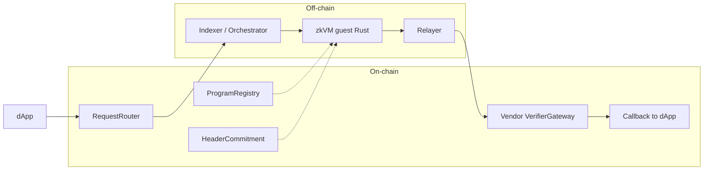

<div align="center">

# ZK-Coprocessor

### Trustless off-chain compute and historical chain data for smart contracts — verified on-chain in one callback.

**The goal: AWS Lambda for Web3** — developers write ordinary Rust; GPUs prove execution; contracts receive a cryptographically guaranteed journal for pennies in gas.

[](Cargo.toml)
[](contracts/)
[](NOTES/MILESTONE_AB_SP1.md)
[](LICENSE)

[**Quickstart**](#-quickstart) · [**Architecture**](#-architecture) · [**Layout**](#-repository-layout) · [**DevEx CLI**](#-developer-experience) · **[End goal](./END_GOAL)** · **[System design](./SDD)**

</div>

---

## Why this exists

Smart contracts cannot scan years of history or run heavy analytics without prohibitive gas or trusted off-chain APIs. **ZK-Coprocessor** lets a contract post a bounty, an orchestrator runs your Rust guest in a zkVM, compresses a proof, and the **gateway** verifies it and **callbacks** into your dApp with the result — binding `requestId`, program identity, and public values so replay and witness lies fail closed.

| Without coprocessor | With ZK-Coprocessor |
|---------------------|---------------------|
| Millions in gas for historical aggregates | ~$0.01–$0.05 SNARK verify on-chain |
| Trust Infura for Merkle witnesses | MPT + header roots verified **inside** the guest |
| Authors write circuits | Authors write Rust + Solidity callbacks |

---

## Architecture



**Principles (v1):** reuse **Succinct SP1** `VerifierGateway` + Groth16; **Axiom-class** padded MMR for header batches; **`env::read_state`** abstracts MPT for app authors; job FSM covers timeouts, refunds, and relayer economics. Details: [`SDD`](./SDD) · locked choices: [`NOTES/LOCKED_DECISIONS.md`](./NOTES/LOCKED_DECISIONS.md).

---

## Quickstart

**Prerequisites:** [Foundry](https://book.getfoundry.sh/), Rust stable, optional [Anvil](https://book.getfoundry.sh/anvil/) for local E2E.

```bash
# Foundry toolchain
curl -L https://foundry.paradigm.xyz | bash && foundryup

# Smart contracts + tests
cd contracts && git clone --depth 1 https://github.com/foundry-rs/forge-std lib/forge-std
forge test -vv

# Rust workspace
cargo test --workspace

# Local pipeline: request → prove (mock) → callback
./scripts/e2e-anvil.sh
```

Evidence & scripts: [`scripts/README-e2e.md`](./scripts/README-e2e.md) · [`NOTES/PHASE0_EVIDENCE.md`](./NOTES/PHASE0_EVIDENCE.md).

**Proving modes**

| Mode | Use |
|------|-----|
| `PROVE_MODE=mock` (default) | Fast local harness with `MockSP1Verifier` |
| `PROVE_MODE=sp1` | Production path — SP1 Groth16 v6.1.0 via `SP1VerifierGateway` |

See [`NOTES/MILESTONE_AB_SP1.md`](./NOTES/MILESTONE_AB_SP1.md).

---

## Repository layout

| Path | Role |
|------|------|
| [`contracts/`](contracts/) | Foundry: gateway, registry, header commitment, prover network interfaces |
| [`guest/`](guest/) | SP1 RISC-V sample program (prove via SP1 toolchain) |
| [`guest-mpt/`](guest-mpt/) | In-guest Alloy-trie MPT verification |
| [`host/`](host/) | Mock prover + E2E helpers |
| [`crates/header-commitment`](crates/header-commitment) | PMMR / MPT helpers for historical trust roots |
| [`crates/orchestrator`](crates/orchestrator) | Job FSM, economics floor, orchestrator binary |
| [`lib/`](lib/) | Shared journal ABI between guest and Solidity |
| [`sdk/guest`](sdk/guest) | `env::read_state` / journal codegen for guest authors |
| [`sdk/ts`](sdk/ts) | TypeScript journal decode helpers |
| [`cli/`](cli/) | `create-zk-coprocessor` scaffold, Anvil deploy, ELF content-addressed store |

---

## Developer experience

Scaffold a coprocessor app, deploy to Anvil, and soak the orchestrator:

```bash
cargo run -p create-zk-coprocessor -- new my-app --template compute
cargo run -p create-zk-coprocessor -- new my-state --template state

# With Anvil running:
cargo run -p create-zk-coprocessor -- deploy --network anvil   # → deployments/anvil.json

HASH=$(cargo run -q -p create-zk-coprocessor -- store-elf --elf path/to/elf)
./scripts/e2e-orchestrator-soak.sh
```

Install CLI: `cargo install --path cli` · optional `npx` via root [`package.json`](package.json) when `cargo` is on `PATH`.

---

## What we're building toward

From [`END_GOAL`](./END_GOAL):

1. **One-line requests from Solidity** — escrow bounty, emit event, receive verified journal in callback.
2. **Historical state without trusting RPCs** — witnesses checked in-circuit against on-chain header commitments.
3. **Shared verifier economics** — one audited gateway; programs registered by content hash.
4. **Prover network path** — orchestrator + GPU cluster + relayer (Flashbots-aware), eventually open operators / AVS.

Build order: [`PHASES`](./PHASES) · validation notes: [`NOTES/PHASE_EVIDENCE.md`](./NOTES/PHASE_EVIDENCE.md).

---

## Status

Active development — **Phase 0** E2E (Anvil + mock prove) and contract suite are in tree; SP1 production verifier path is documented and wired behind `PROVE_MODE`. Not production-audited; APIs will evolve with [`SDD`](./SDD).

---

<div align="center">

<sub>Questions or design feedback? Open an issue or see <code>NOTES/</code> for milestone evidence.</sub>

</div>
